# 3D Point Cloud Fusion & Registration in Underwater Environments with Low-Rate Acoustic Sensors

[-0369a1?style=flat-square)](https://fcfm.uchile.cl/)

> **Engineering Thesis Showcase**  
> **Title:** *Algoritmos para la Fusión y Registro de Nubes de Puntos en Medios Subacuáticos Basados en Sensores Acústicos de Baja Tasa de Muestreo*  
> **Author:** Sebastián Alberto Herrera Torres · Department of Electrical Engineering, Universidad de Chile (Oct 2026)

---

## Abstract & Problem Statement

Inspecting flooded hydroelectric adduction tunnels with Remotely Operated Vehicles (ROVs) presents severe perception and localization challenges:
1. **Zero Optical Visibility & Featureless Geometry:** High turbidity and total darkness render optical cameras ineffective, while long rectilinear rock/concrete tunnels lack distinctive landmarks.
2. **Helical Motion Distortion (*Motion Skew*):** Mechanical profiling sonars (such as the **Imagenex 831A**) rotate a single piezoceramic transducer step-by-step over $360^\circ$. At a $6\text{ m}$ range, a full sweep requires $\sim 3.3\text{ s}$ ($\sim 0.3\text{ Hz}$). As the ROV advances longitudinally during a sweep, the resulting cross-section is stretched into a 3D helix rather than a planar ring.
3. **Inertial Drift & Acoustic Dropouts:** Magnetic interference and gyroscope bias degrade IMU heading estimates over multi-hour missions, while Doppler Velocity Logs (DVL) suffer intermittent bottom-lock dropouts over uneven tunnel floors.

This work presents an end-to-end architecture combining **asynchronous multi-sensor state estimation (15-DOF EKF/UKF)**, a **3-tier odometry contingency system**, a **Gazebo Harmonic + ROS 2 Jazzy simulation benchmark**, and an **11-stage offline 3D point cloud registration pipeline**, validated both in simulation and across a **1.8 km hydroelectric tunnel inspection in Central America**.

  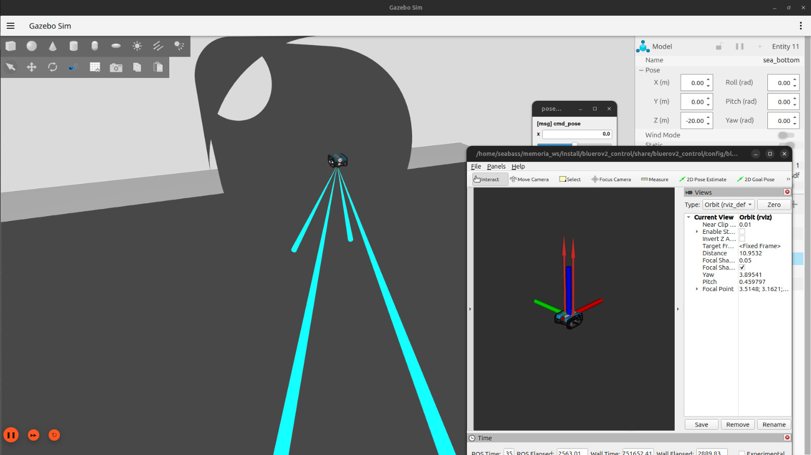
  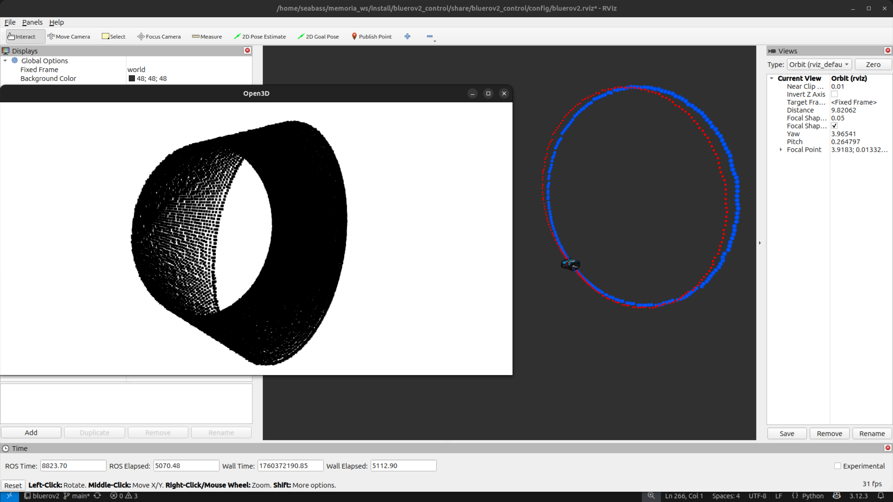
  
<em>Left: BlueROV2 operating inside the procedurally generated tunnel in Gazebo Harmonic. Right: Real-time trajectory visualization in RViz2 alongside initial Open3D acoustic sweep reconstructions.</em>

---

## 1. Multi-Sensor Fusion & State Estimation Architecture

To estimate the 6-DOF pose of the ROV in GPS-denied tunnels, a dual filter architecture was implemented on top of `robot_localization` in **ROS 2 Jazzy**, running an **Extended Kalman Filter (EKF)** and an **Unscented Kalman Filter (UKF)** in parallel over the same 15-dimensional state vector:

$$\mathbf{x} = [x, y, z, \phi, \theta, \psi, v_x, v_y, v_z, \omega_x, \omega_y, \omega_z, a_x, a_y, a_z]^T$$

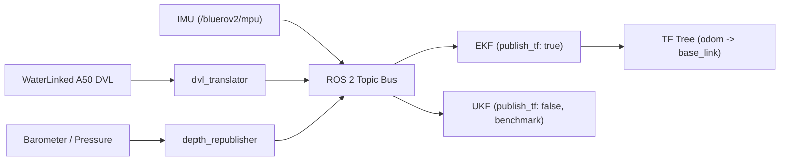

### Sensor Fusion Configuration

| Sensor | ROS 2 Message Type | Fused State Variables | Design Rationale |
| :--- | :--- | :--- | :--- |
| **IMU (`imu0`)** | `sensor_msgs/Imu` | $\phi, \theta, \psi, \omega_x, \omega_y, \omega_z$ | Provides high-rate attitude and angular velocity; configured with `imu0_relative: true` in field operations. |
| **DVL (`twist0`)** | `geometry_msgs/TwistWithCovarianceStamped` | $v_x, v_y$ (Surge, Sway) | Planar body-frame velocities with Mahalanobis outlier rejection threshold ($\tau = 2.5$). Vertical velocity $v_z$ is explicitly excluded to prevent drift against hydrostatic depth. |
| **Barometer (`pose0`)** | `geometry_msgs/PoseWithCovarianceStamped` | $z$ (Depth) | Linear hydrostatic pressure-to-depth conversion ($P(z) = P_{\text{atm}} + \rho g z$), bounding vertical drift across kilometer-scale missions. |

### 3-Tier Odometry Contingency System (Field Deployment)

During real-world tunnel inspections, unmodeled magnetic disturbances and DVL dropouts can cause full 6-DOF filters to diverge laterally. A 3-tier progressive DOF-degradation architecture was engineered:

| Tier | Node / Mode | Active Degrees of Freedom | Operational Scenario |
| :---: | :--- | :--- | :--- |
| **Level 1 (Full 6-DOF)** | Direct EKF Output | $X, Y, Z, \text{Roll}, \text{Pitch}, \text{Yaw}$ | Nominal multi-sensor operation. |
| **Level 2 (Controlled)** | `lvl2_controlled_odom` | $X, Z, \text{Yaw}$ ($Y = 0, \text{Roll} = 0, \text{Pitch} = 0$) | Mitigates lateral ($Y$) drift while preserving heading changes. |
| **Level 3 (Rail Mode)** | `lvl3_rail_odom` | $X, Z$ (Pure longitudinal + depth projection) | Severe IMU yaw divergence in rectilinear adduction tunnels. |

  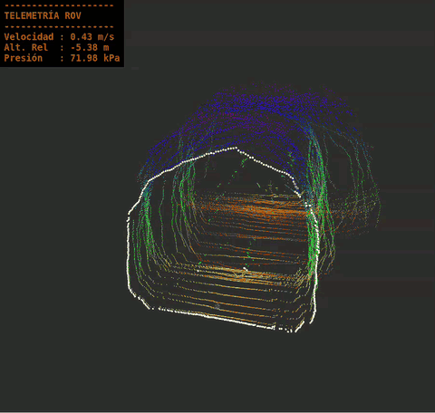
  
<em>Real-time field inspection telemetry and 3D tunnel profiling in RViz2 (12x speed) using the contingency odometry pipeline.</em>

---

## 2. Quantitative Simulation Benchmarks (EKF vs. UKF)

### Experiment A: 1 km Straight Tunnel Drift Benchmark

Evaluates longitudinal dead-reckoning drift accumulation across a $1\text{ km}$ tunnel at three cruise speeds ($0.40\text{ m/s}$, $0.71\text{ m/s}$, and $0.92\text{ m/s}$):

| Speed | Filter | $\text{RMSE}_X$ (m) | $\text{RMSE}_Y$ (m) | $\text{MAE}_X$ (m) | $\text{MAE}_Y$ (m) | $\text{Max}_X$ (m) | $\text{Max}_Y$ (m) | $\text{NEES}_X$ |
| :---: | :---: | :---: | :---: | :---: | :---: | :---: | :---: | :---: |
| **0.40 m/s** | EKF | 2.684 | 0.052 | 2.280 | 0.049 | 4.728 | 0.084 | 0.094 |
| **0.40 m/s** | UKF | 3.709 | 0.060 | 3.144 | 0.055 | 6.555 | 0.115 | 0.180 |
| **0.71 m/s** | EKF | 4.077 | 0.037 | 3.450 | 0.032 | 7.433 | 0.064 | 0.302 |
| **0.71 m/s** | UKF | 3.339 | 0.018 | 2.832 | 0.015 | 6.103 | 0.061 | 0.203 |
| **0.92 m/s** | EKF | 2.594 | 0.020 | 2.232 | 0.018 | 4.561 | 0.058 | 0.100 |
| **0.92 m/s** | UKF | 3.907 | 0.033 | 3.340 | 0.027 | 6.883 | 0.071 | 0.226 |

  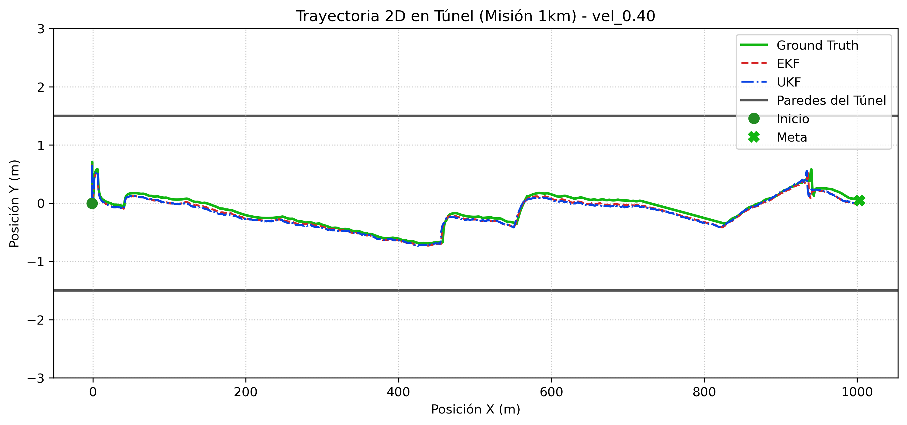
  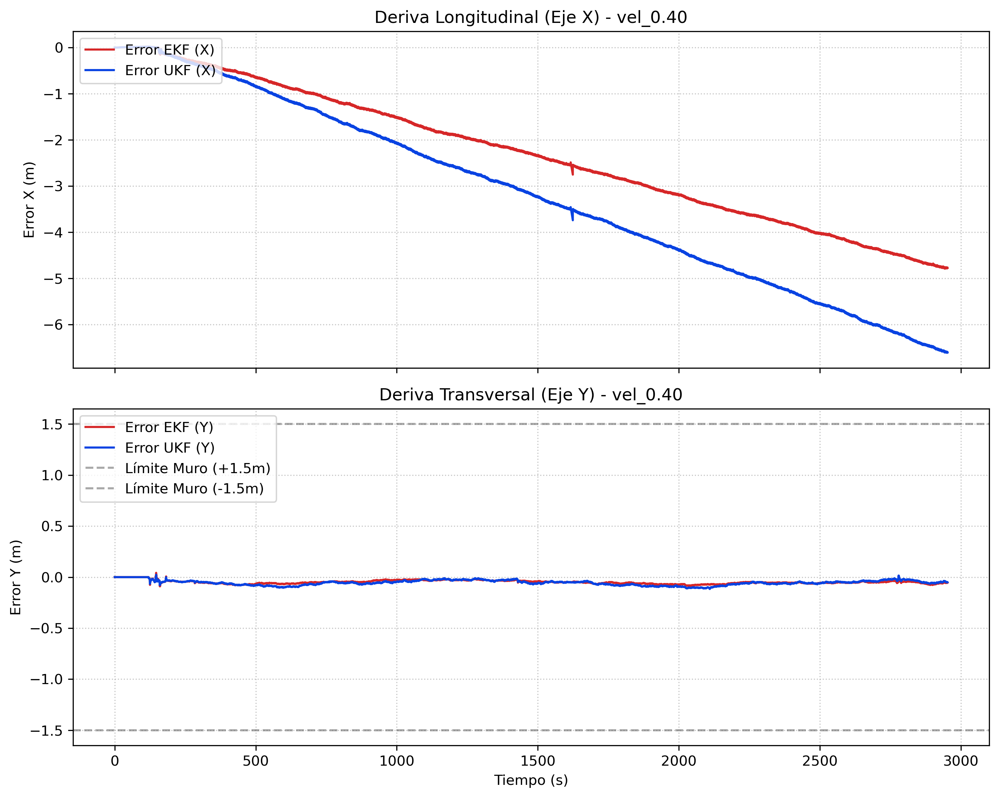
  
<em>Left: Estimated trajectories vs. Ground Truth over a 1 km straight tunnel at 0.40 m/s. Right: Axis-by-axis estimation error breakdown over time.</em>

### Experiment B: Nonlinear Maneuvers Under Variable Altitude (Adaptive DVL Rate)

Because the WaterLinked A50 DVL adjusts its acoustic ping rate inversely with altitude above the bottom, nonlinear teleoperated maneuvers (sharp turns, variable speed) were evaluated across four altitudes ($6\text{ m}$ to $45\text{ m}$):

| Altitude | ROV Depth (m) | DVL Freq (Hz) | EKF RMSE (m) | UKF RMSE (m) | EKF MAE (m) | UKF MAE (m) | EKF Max (m) | UKF Max (m) | EKF / UKF NEES |
| :---: | :---: | :---: | :---: | :---: | :---: | :---: | :---: | :---: | :---: |
| **6 m** | 1.18 | 12.25 | 0.377 | **0.104** | 0.312 | **0.088** | 0.672 | **0.231** | 0.013 / **0.001** |
| **15 m** | 1.13 | 10.59 | 0.442 | **0.099** | 0.356 | **0.083** | 0.838 | **0.212** | 0.016 / **0.001** |
| **30 m** | 1.14 | 7.63 | 0.397 | **0.142** | 0.339 | **0.127** | 0.693 | **0.259** | 0.014 / **0.003** |
| **45 m** | 1.15 | 4.65 | 0.572 | **0.208** | 0.502 | **0.177** | 0.957 | **0.413** | 0.031 / **0.007** |

> **Key Finding:** Under strongly nonlinear dynamics, the **UKF outperforms the EKF by 2.7x to 4.5x in RMSE** across all altitudes (achieving a **77.6% RMSE reduction** at $15\text{ m}$ altitude, from $0.442\text{ m}$ down to $0.099\text{ m}$) and maintains an order-of-magnitude lower NEES due to sigma-point propagation through nonlinear $SE(3)$ kinematics.

  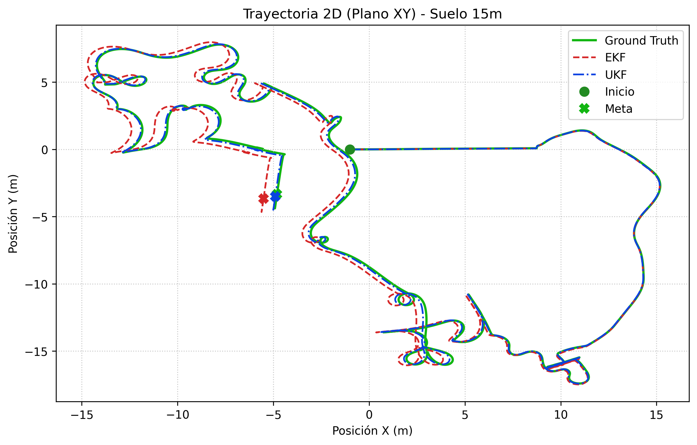
  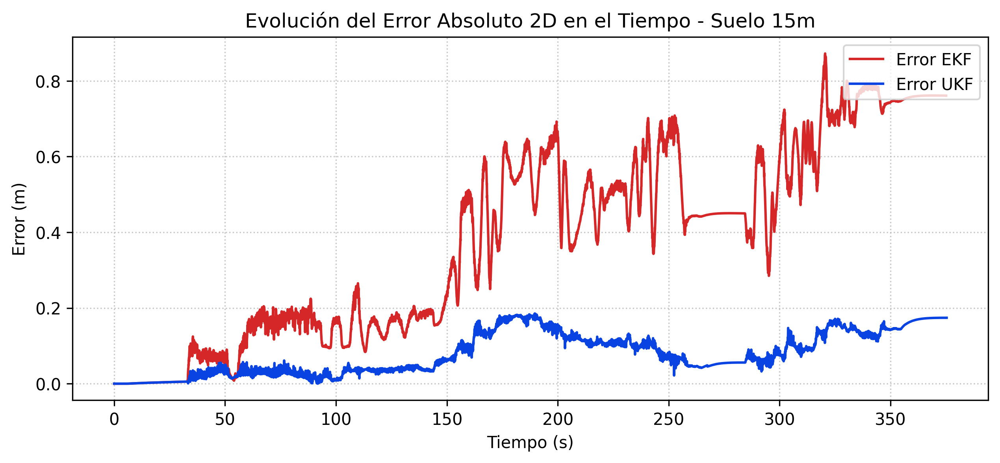
  
<em>Nonlinear maneuver benchmark at 15 m altitude (10.59 Hz DVL update rate): 2D trajectory comparison (left) and position error evolution over time (right).</em>

---

## 3. Helical Motion Deskewing & 11-Stage 3D Reconstruction Pipeline

### Helical Scan Unrolling Formulation

Given a mechanical profiling sonar with sweep frequency $f_{\text{scan}}$, each beam $i \in \{0, \dots, N-1\}$ at azimuth $\theta_i = \text{atan2}(y_i, x_i)$ is captured at timestamp:

$$t_i = t_{\text{base}} + \left(\frac{\theta_i + \pi}{2\pi}\right) \cdot \frac{1}{f_{\text{scan}}}$$

Instead of projecting the entire $360^\circ$ scan from a single snapshot pose, [`scripts/helical_reconstruction.py`](./scripts/helical_reconstruction.py) interpolates the vehicle position $\mathbf{p}(t_i)$ linearly and orientation $\mathbf{q}(t_i) \in S^3$ via Normalized Linear Interpolation (NLERP) with hemisphere correction ($\mathbf{q}_1 \leftarrow -\mathbf{q}_1$ if $\mathbf{q}_0 \cdot \mathbf{q}_1 < 0$), transforming all $N$ beams in vectorized form:

$$\mathbf{p}_i^{\text{global}} = \mathbf{R}(\mathbf{q}(t_i)) \, \mathbf{R}_{\text{sensor}} \, \mathbf{p}_i^{\text{local}} + \mathbf{p}(t_i)$$

  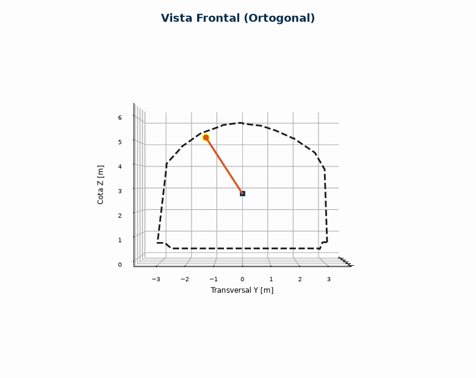
  
<em>Helical motion distortion (motion skew): what appears as a planar 2D cross-section in frontal projection is revealed in 3D as a stretched helical spiral caused by the longitudinal displacement ($\Delta X$) of the ROV during a single $360^\circ$ mechanical sonar sweep.</em>

  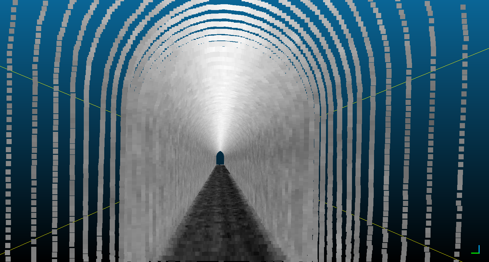
  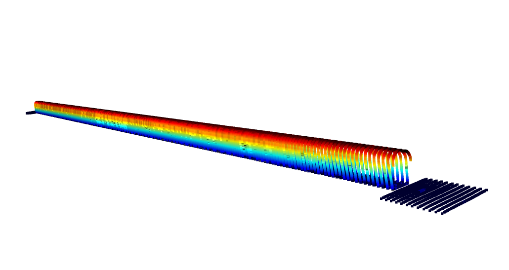
  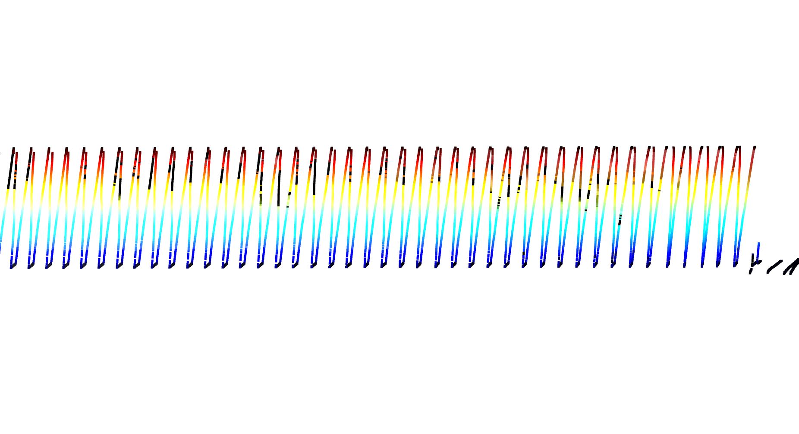
  
<em>Simulated 3D tunnel reconstruction: interior longitudinal perspective in CloudCompare (left), global horizontal view in Open3D (center), and close-up of the unrolled helical scan geometry (right).</em>

### Real-Time Acquisition & 11-Stage Offline Post-Processing

For live field operations, a custom **ROS 2 Jazzy** driver (`imagenex831a_ros2`) was developed to interface with the **Imagenex 831A** profiling sonar over RS-485 (`115200` baud), supporting hot-reloadable acoustic parameters via `rqt` and real-time operator telemetry in RViz2:

  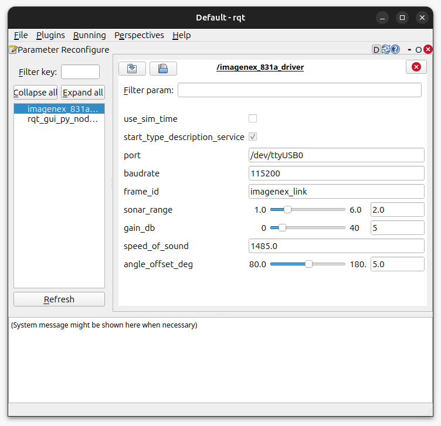
  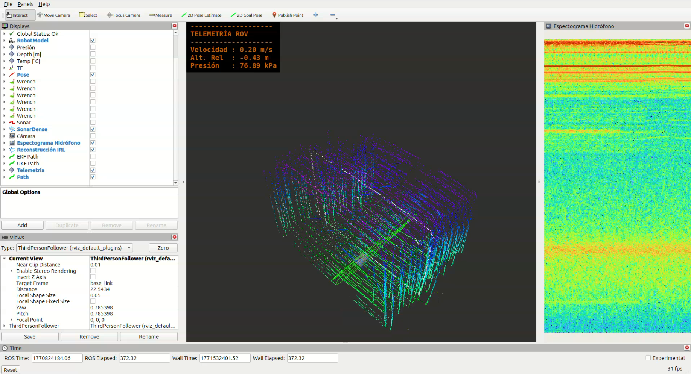
  
<em>Left: Runtime parameter reconfiguration in rqt for the Imagenex 831A ROS 2 driver. Right: Full RViz2 operator HUD combining live 3D acoustic reconstruction, artificial horizon, and hydrophone spectrogram.</em>

Offline, raw inspection bags are processed through an **11-stage sequential pipeline**:
1. **Topographic Ground Control Point (GCP) Odometry Calibration:** Piecewise linear scale-drift correction (`scipy.interpolate.interp1d`) + exponential low-pass depth filtering ($z_k = 0.1 z_{\text{raw}} + 0.9 z_{k-1}$).
2. **Helical Deskewing & 20 m Progressive Binning:** Per-beam pose interpolation + Statistical Outlier Removal (`nb_neighbors=15`, `std_ratio=1.5`).
3. **Segment Quality Inspection:** Rapid visual screening for DVL bottom-lock loss.
4. **Interactive Open3D Fine Alignment & Topographic Heuristics:** Ring-by-ring $SE(3)$ registration tool with automatic floor (99th percentile) and right-wall (5th percentile) heuristic alignment.
5. **Global Assembly & Topographic Offset Registration**
6. **Aligned Point Cloud Export (`.pcd` / `.ply`)**
7. **Surface Mesh Generation (Alpha Shape vs. Poisson Reconstruction Analysis)**
8. **3D Mesh Inspection**
9. **Automated Cross-Sectional Profile Sheets ($\pm 1.5\text{ m}$ slices)**
10. **Design-vs-Actual Topographic Overlay Generation**
11. **XYZ Topographic Vector Deliverable Export**

  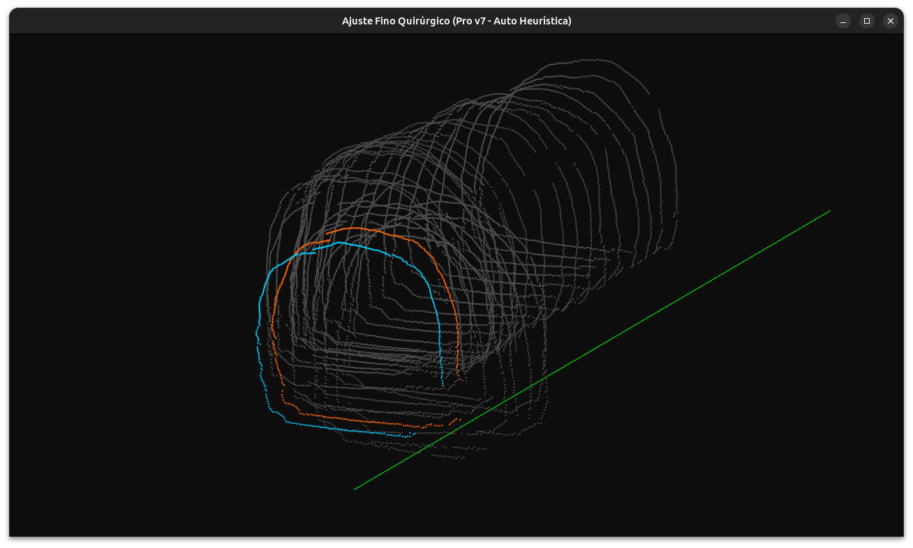
  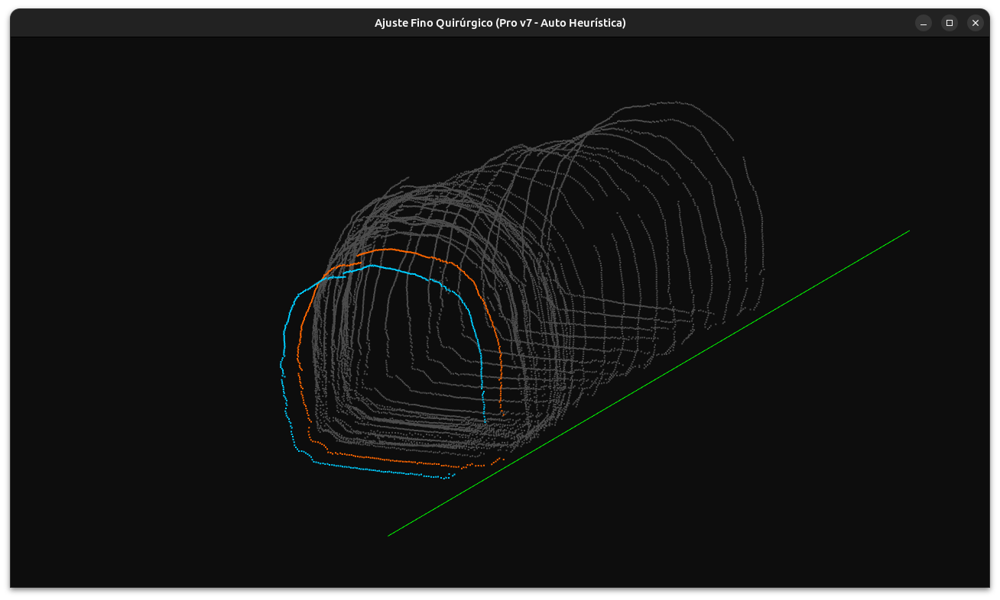
   
  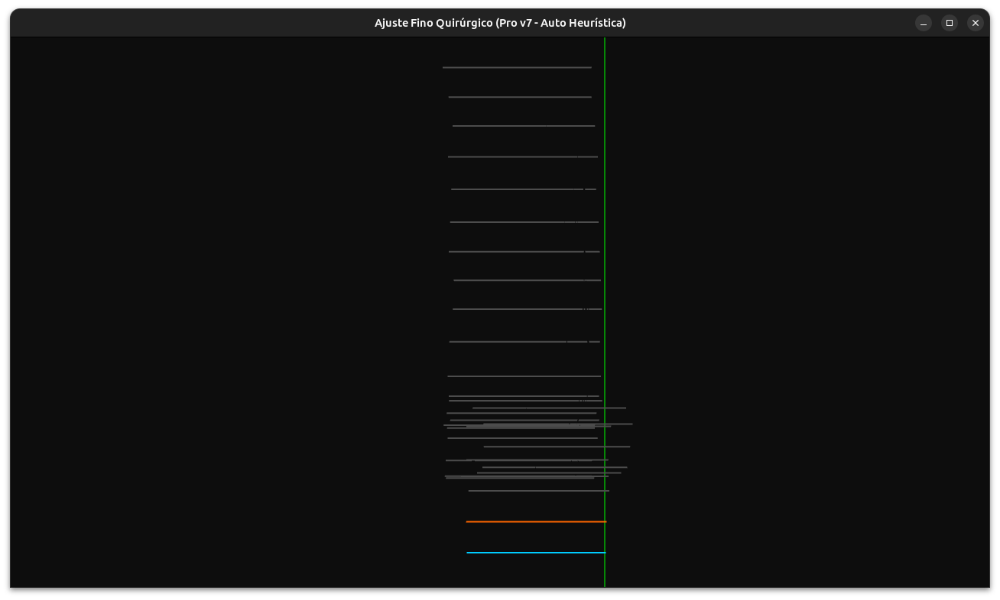
  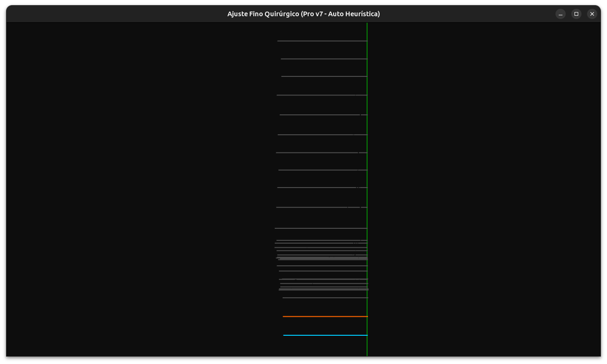
  
<em>Stage 4 Heuristic Ring Alignment in Open3D: 20 m tunnel segment before (left) and after (right) automatic floor/wall percentile alignment, shown in front perspective (top row) and top-down perspective (bottom row).</em>

  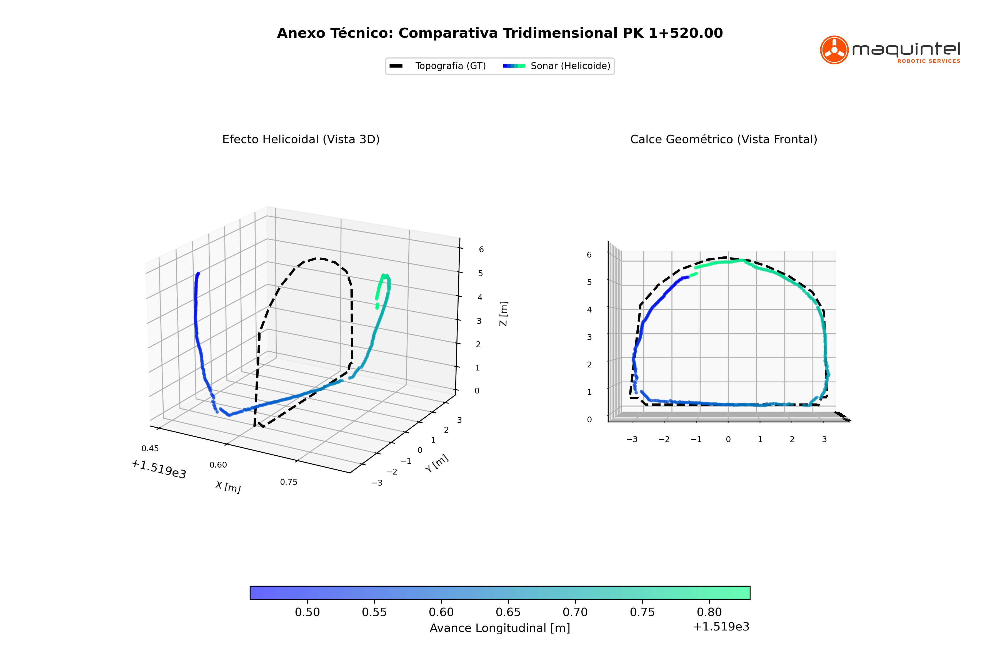
  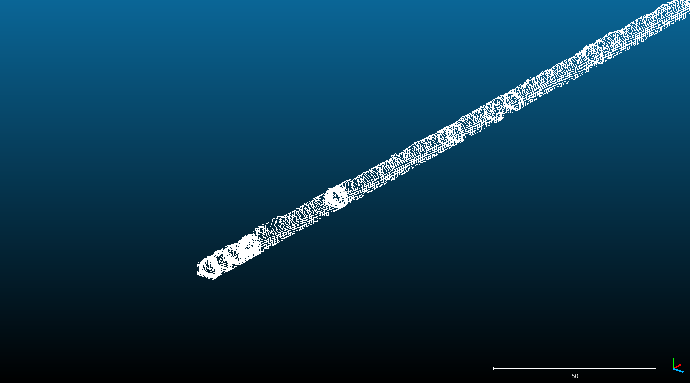
  
<em>Left: 3D cross-sectional profile extraction ($\pm 1.5\text{ m}$ slice) illustrating how the helical scan intersects the tunnel walls. Right: Top-down view of a 300 m section from the 1.8 km reconstructed hydroelectric tunnel, achieving a 20x increase in profiling density over legacy manual inspection points and revealing 2 previously undocumented structural anomalies.</em>

---

## 4. Exploratory Study: Acoustic Vision Odometry (Oculus M3000d Multibeam Sonar)

As a complementary research study, visual-acoustic odometry techniques were evaluated on high-frequency multibeam forward-looking sonar imagery (**Blueprint Subsea Oculus M3000d**) to assess whether 2D acoustic video can bound yaw drift when both IMUs diverge:

1. **Polar Grid Artifact Removal via Telea Inpainting:** Raw acoustic frames include baked-in polar coordinate overlays that corrupt gradient and keypoint detectors. Morphological thresholding + OpenCV Telea inpainting cleanly reconstructs the underlying acoustic backscatter field.
2. **Feature-Based Odometry (ORB / AKAZE + RANSAC):** While inpainting shifts feature tracking from static grid intersections onto real rock walls, suspended particulate matter (*marine snow*) and viewpoint-dependent acoustic shadows induce cumulative rotational drift.
3. **Geometric Structural Tracking (Hough Transform vs. Principal Axes of Inertia):** Combining Hough line extraction with second-order image moments bounds long-term heading drift inside straight tunnel sections without relying on inertial integration.

  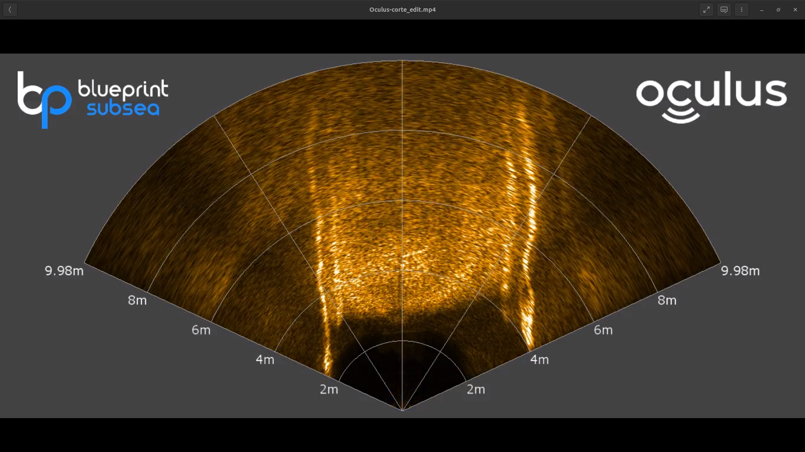
  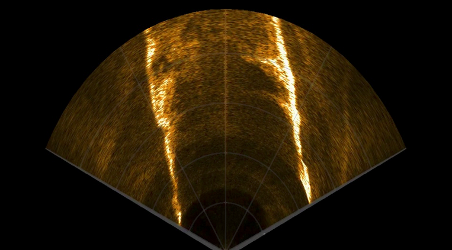
  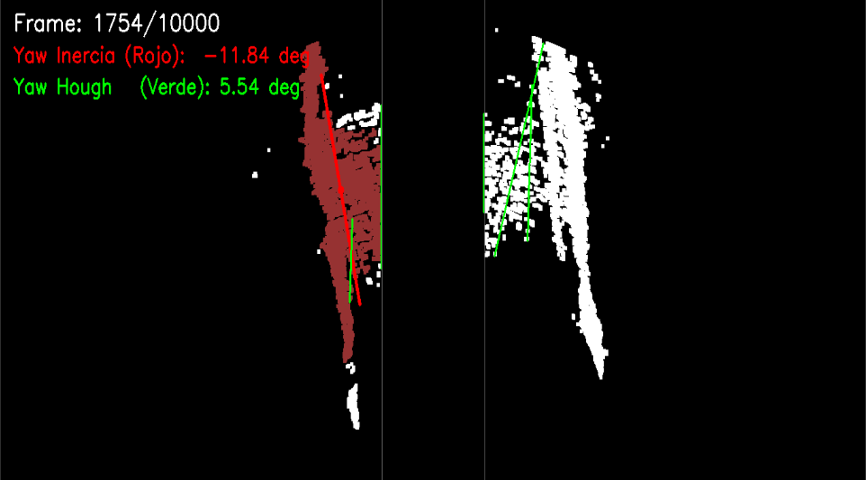
   
  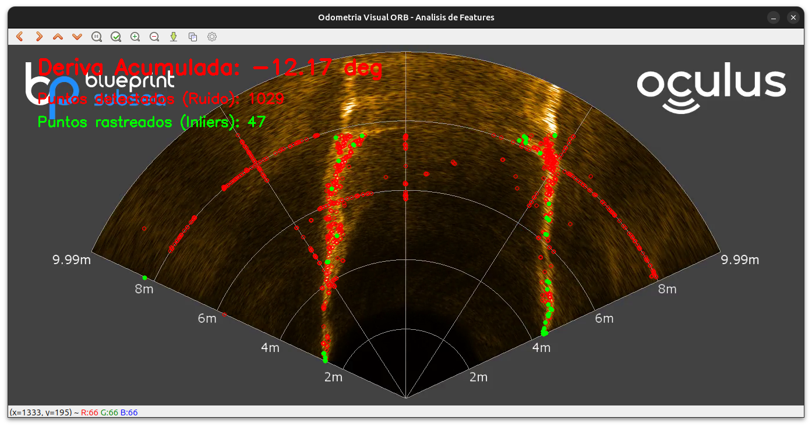
  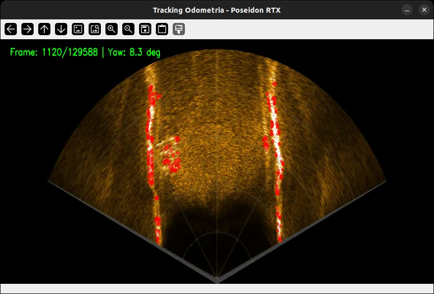
  
<em>Top row: Raw Oculus M3000d multibeam sonar frame (left), grid removal via Telea inpainting (center), and hybrid Principal Inertia Axis + Hough wall tracking (right). Bottom row: ORB + RANSAC feature matching before inpainting (anchored to static grid artifacts, left) vs. after inpainting (tracking physical rock features, right).</em>

---

## Repository Contents

- [`scripts/helical_reconstruction.py`](./scripts/helical_reconstruction.py): Vectorized $SE(3)$ helical motion-distortion deskewing and Open3D point cloud reconstruction from ROS 2 MCAP bags.
- [`scripts/benchmark_metrics.py`](./scripts/benchmark_metrics.py): Automated EKF vs. UKF trajectory evaluation script computing 2D/3D RMSE, MAE, Max Error, and Normalized Estimation Error Squared (NEES).
- [`figures/`](./figures/): Simulation benchmarks, RViz2/Open3D visualizations, and field validation figures from the thesis.
